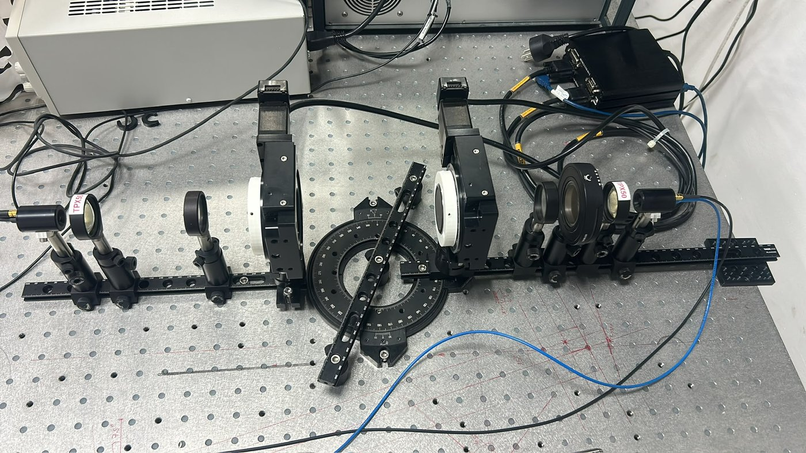
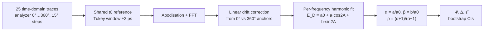
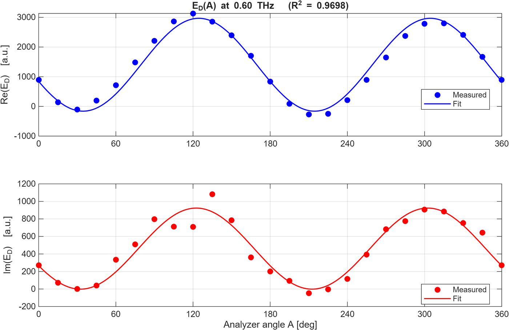
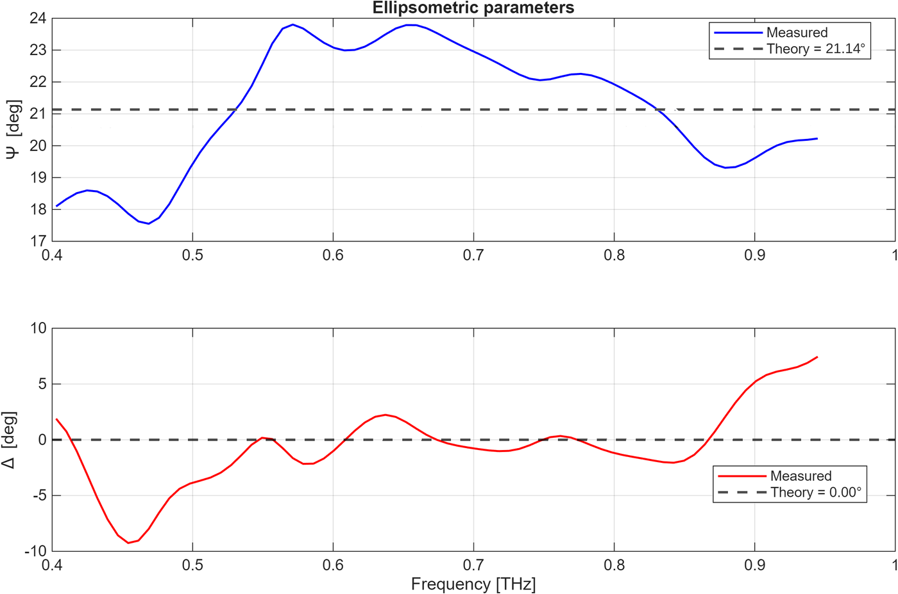
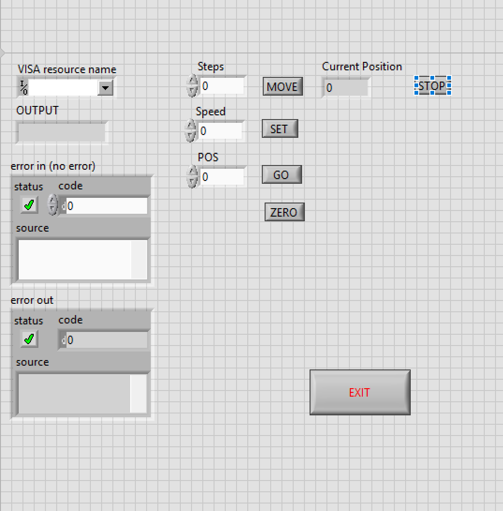

# Terahertz Ellipsometry Measurement System

Design, construction and calibration of a **variable-analyzer-angle THz ellipsometer**, built around a commercial THz time-domain spectroscopy (THz-TDS) core, and its first application to the van der Waals antiferromagnet **FePS₃**.

B.Sc. final project, Dept. of Electrical & Electronics Engineering, Ariel University. Carried out at the CoMiQs Lab, Dept. of Physics. Supervisor: Dr. Nimrod Bachar. **Final grade: 95.**

<p align="center">
  
</p>

---

## Why THz Ellipsometry

The complex dielectric function ε̃(ω) of a material carries the signature of its low-energy excitations (free carriers, phonons, magnons), and in quantum and layered materials many of these sit in the terahertz band. Ellipsometry measures the complex ratio of the Fresnel reflection coefficients

```
ρ = r_p / r_s = tan(Ψ) · e^{iΔ}
```

so the source spectrum, the atmosphere and every element common to both polarisations cancel identically: no reference sample is needed. THz ellipsometers are rare, and no THz ellipsometric data had been reported for FePS₃.

## What I Built

| Subsystem | Description |
|---|---|
| **Optical geometry** | Two-arm goniometric reflection stage on a common rotation axis; selectable angle of incidence (60°, 70°, 75° used) without optical realignment |
| **Polarisation control** | Three free-standing wire-grid polarisers: emitter side fixed at 45°, motorised analyzer scanned 0–360°, fixed 135° polariser before the receiver to cancel the non-ideal antenna response |
| **Sample holder** | Custom 12.7 mm conical holder that keeps the sample surface on the rotation axis and deflects beam overspill |
| **Signal processing** | Full MATLAB chain: windowing and apodisation, FFT, per-bin harmonic fit, drift correction, analytical inversion to ρ, bootstrap uncertainties, thin-film inversion to n + ik |
| **Motion control** | Closed-loop NEMA17 lead-screw stage (0.4 µm/step), ESP-based controller with an ASCII serial protocol, and a LabVIEW control VI |

THz source and detection: Menlo Systems TERA K15 (1560 nm fibre laser, photoconductive-antenna emitter and receiver, optical delay line, lock-in readout).

## Signal Processing Pipeline



- **Variable analyzer angle method:** at every frequency bin, the detected field follows a second harmonic in the analyzer angle A. A linear least-squares fit on the real and imaginary parts gives α and β, and ρ follows analytically.
- **Built-in self-test:** for a diagonal (isotropic) Jones matrix the coefficient β must equal −1 *independently of the sample*, which gives a falsifiable check on every measurement.
- **Drift correction:** the scan covers the full 360°, so A = 0° and A = 360° are physically identical; their difference is used as a time-stamped linear drift anchor.
- **Uncertainties:** bootstrap resampling over analyzer angles (300 resamples), propagated through to Ψ and to the optical constants.
- **Thin-film inversion:** coherent three-layer (air / FePS₃ / Si) Fresnel model solved per frequency with `fsolve`, using continuation from the previous bin to stay on a physical branch.

Code: [`matlab/thz_ellipsometry_processing.m`](matlab/thz_ellipsometry_processing.m)

## Validation on a Silicon Reference

High-resistivity Si (n = 3.418, lossless, non-dispersive) gives three independent analytic predictions. All three were met **with no empirical calibration offset**:

| Test | Prediction | Measured |
|---|---|---|
| Harmonic form of E_D(A) | pure 2nd harmonic | mean R² = **0.968** (worst 0.958) |
| Sample-independent coefficient β | −1 | **−0.997 + 0.017i**, std \|β+1\| = 0.019 |
| Ellipsometric phase Δ | 0° | **−0.64°** |
| Ellipsometric amplitude Ψ | 21.14° (Fresnel) | **21.18°**, residual = 0.5° AOI offset, within the scale uncertainty |
| Usable bandwidth (N₂ purge) | ≥ 2 THz | **≈ 2.5 THz** |

| Harmonic fit at 0.60 THz | Ψ(f) and Δ(f) vs. theory |
|---|---|
|  |  |

## FePS₃: First THz Ellipsometric Measurement

An 80 µm FePS₃ flake on silicon was measured at three angles of incidence (23 analyzer positions per angle, bootstrap uncertainties).

- The internal-consistency test **did not pass**: β departed from −1 (Re β = −1.07, −1.09, −1.64) and Ψ exceeded the 45° isotropic ceiling at 60°.
- A controlled comparison against the holder-free silicon measurement **traced the failure to an additive parasitic reflection from the sample holder**, which adds coherently inside the analysis window.
- Apparent optical constants were extracted within the isotropic model, as a room-temperature baseline for the planned cryogenic measurements.

The result is reported as a negative finding with an identified cause. It defines what the next measurement needs: holder suppression (THz-absorbing coating plus a Si-in-holder control), bandwidth beyond 4 THz to reach the 3.6–3.7 THz magnon, and integration of the motion stage for cryogenic operation.

## Motion-Control Subsystem

A separate engineering deliverable, prepared for the cryostat stage where the sample cannot be reached by hand.

| Parameter | Value |
|---|---|
| Actuator | NEMA17 closed-loop stepper (integrated encoder + driver), T-type lead-screw stage, MGN12H carriage |
| Resolution | 8 mm lead / 20 000 steps per rev = **0.4 µm/step** |
| Repeatability | 30 µm bidirectional (vendor spec), 50 mm stroke |
| Controller | ESP-based, ASCII commands `MOVE`, `GO`, `SET`, `ZERO`, `STOP` at 115 200 baud |
| Host software | LabVIEW VI: VISA serial, event-driven state machine, position readback and logging |

<p align="center"></p>

## Repository Contents

| Path | Contents |
|---|---|
| [`docs/Final_Project_Report.pdf`](docs/Final_Project_Report.pdf) | Full report (70 pp.): theory, Jones-matrix derivations, system design, results, BOM |
| [`matlab/thz_ellipsometry_processing.m`](matlab/thz_ellipsometry_processing.m) | Main processing script (harmonic fit, bootstrap, inversion) |
| [`figures/`](figures) | Setup photo, validation plots, sample holder, LabVIEW VI |

The windowing, apodisation and FFT helpers (`WindowTDSDataMenlo`, `AppodizeTDSData`, `CalcTDSFFT_Menlo_New`) belong to the lab's existing processing library and are not included. Raw measurement data are not included.

## Skills Demonstrated

THz-TDS · ellipsometry · Jones calculus · Fresnel and thin-film modelling · spectral analysis and windowing · least-squares harmonic fitting · bootstrap statistics · nonlinear inversion · MATLAB · LabVIEW · closed-loop motion control · optomechanical design · experimental validation against acceptance criteria

## Acknowledgments

Dr. Nimrod Bachar for supervision and the THz ellipsometry calibration protocol; Daniel Bazyliansky for extensive help with building and calibrating the system; the CoMiQs Lab, Ariel University.
